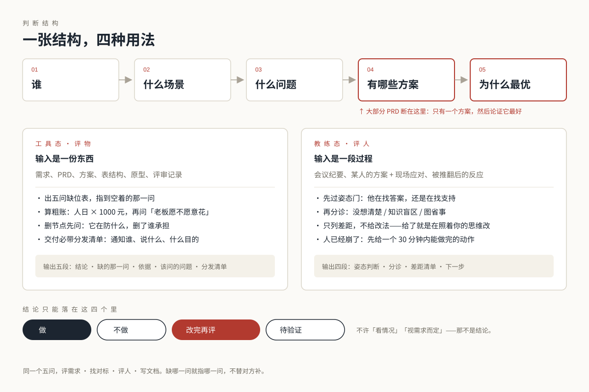
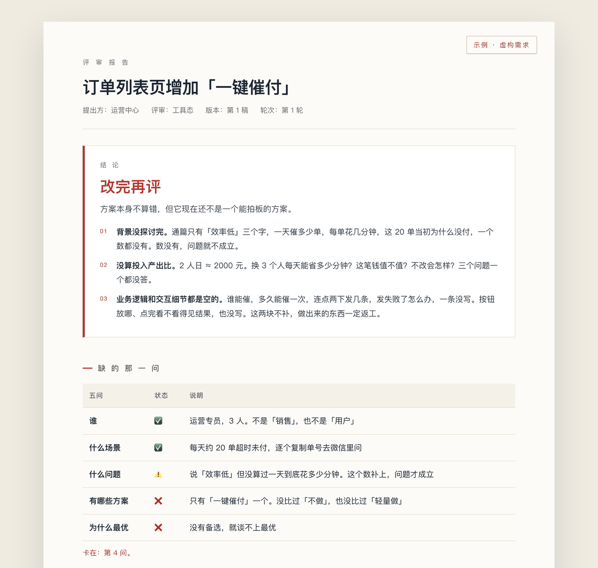

# 产品Ronchi · PM-Ronchi

**它不写 PRD，只指出你漏掉的那一问。**

> 中文名 **产品Ronchi**｜英文名 **PM-Ronchi**｜技能标识 `pm-ronchi`｜开源 agent skill

[](./CHANGELOG.md)
[](./LICENSE)
[](https://www.python.org/)
[](./scripts)
[](./SKILL.md)

[▸ 看一眼在线示例](https://ronchizhang.github.io/pm-ronchi/demo-review.html)　·　[▸ 完整使用手册](./docs/GUIDE.md)　·　[▸ 变更记录](./CHANGELOG.md)



---

## 它解决什么问题

现在人人都在用 AI 写 PRD，写出来也挺顺。它答的是「怎么做」，「为什么是这个做法」没人问。

真实的需求评审要判的是这个方案成不成立，文档写得好不好在其次。要判成不成立，这几问得先答上：

- 谁在用：说得出来是哪 3 个人，还是「用户」两个字
- 什么场景下：一天几次，每次多久
- 到底什么问题：是效率低，还是不敢拒绝
- **评过哪些方案**：只有一条，还是比过「不做」和「轻量做」
- **为什么这条最优**：有依据，还是因为它是第一个想到的

前四问答完，才有资格谈第五问。大部分 PRD 的病，都出在只有一个方案，然后论证它最好。

这套东西把这个判断顺序固定下来，然后一稿一稿地用。

## 它和「又一个 AI 顾问」的区别

| | 通用的 AI 产品顾问 | 这一套 |
|:--|:--|:--|
| 真相来源 | 你的提示词、模型的记忆 | 摆到桌面上的事实，和缺失的那一问 |
| 结论 | 面面俱到的建议 | 一句给死：做 / 不做 / 改完再评 / 待验证 |
| 方法 | RICE · KANO · AARRR 通用框架 | 五问主链 + 15 条硬规则 |
| 没依据时 | 编一个听起来合理的 | 标 `【引申】` / `【通用】`，或者说「这块没给判据」 |
| 写 PRD | 直接帮你写一版 | **拒绝**。只报差距，改法留给你自己出 |
| 评人 | 给建议 | 先判姿态，再分诊（没想清楚 / 知识盲区 / 图省事） |

## 输出长什么样



*示例用的是虚构需求「订单列表页增加一键催付」。结论给一句话加三条判断，五问表指到断在第几问，后面还有业务逻辑与交互细节各六个缺口。[打开完整报告 →](https://ronchizhang.github.io/pm-ronchi/demo-review.html)*

工具态固定五段：**结论 · 缺的那一问 · 依据 · 该问的问题 · 分发清单**。
教练态固定四段：**姿态判断 · 分诊 · 差距清单 · 下一步**。
人已经崩了的时候是例外，四段全让位，先给一个 30 分钟内能做完的动作。

## 装：把链接丢给 AI

不用敲命令。把链接发给你的 AI 助手（WorkBuddy、Claude Code、Codex 都行），说一句「装这个技能」：

```
https://github.com/ronchizhang/pm-ronchi
```

它会自己放进 `~/.workbuddy/skills/`（Claude Code 是 `~/.claude/skills/`），目录名用 `pm-ronchi`。
装完开个新对话，直接说需求：

> 用「产品Ronchi」帮我看看这个需求值不值得做
> 评审一下这份 PRD
> 这份 docx 你看下交互

评人要明说「这次评人」，它默认评物。

<details>
<summary>AI 装不上时，手动三条命令</summary>

```bash
git clone https://github.com/ronchizhang/pm-ronchi.git ~/.workbuddy/skills/pm-ronchi
# Claude Code 换路径：~/.claude/skills/pm-ronchi
```

再用 `python3 scripts/extract_prd.py --help` 验证一下，能打出用法就装好了。

</details>

取材脚本（可选，把 docx / html / md / xlsx 拆成图文配对）：

```bash
python3 ~/.workbuddy/skills/pm-ronchi/scripts/extract_prd.py 你的PRD.docx -o ./prd-extract
```
纯标准库，零第三方依赖，Mac 和 Windows 都能跑。

## 目录

```
pm-ronchi/
├── SKILL.md                      入口：双态路由、五问主链、15 条硬规则、8 条禁止行为
├── docs/
│   ├── GUIDE.md                  完整使用手册（能力表、8 个案例、扩展方法）
│   ├── index.html                落地页
│   ├── demo-review.html          示例评审报告（虚构需求）
│   └── structure.svg             结构图
├── references/
│   ├── core-principles.md        判据全集，每条标【原话】/【引申】
│   ├── review-playbook.md        工具态十步 + 检查项 + 追问句式
│   ├── coach-playbook.md         教练态三道门：姿态 → 韧性 → 分诊
│   ├── interaction-review.md     交互评审：取材 → 对账 → 列表页/详情页/组件 → 报法
│   ├── writing-spec.md           产出侧：线框四级、BR/IR/FR 归属、字段表、标号法
│   ├── impact-translation.md     12 维度影响翻译表
│   └── voice.md                  措辞红线：判方案不判人
├── assets/
│   └── review-report-template.md 评审报告模板
└── scripts/
    └── extract_prd.py            取材脚本（纯标准库）
```

## 它拒绝做的事

- **五问不全，不评方案。** 缺哪一问就指哪一问，不替你补。
- **没有备选的「最优」不成立。** 至少问过「不做」和「轻量做」。
- **不编造没给过的判据。** 每条判断标出处：`【原话】` / `【引申】` / `【通用】`，三类不许混。
- **不替你写 PRD。** 给了改法，你就是在照着别人的思维改。
- **不用「皮实」压人。** 批评站不住、或者反复推翻不给理由，那是判断机制的问题，不是谁逆商不够。
- **没有图、没有能打开的页面，就不评交互。** 只评「有没有写」，并明说这个缺口。

## 已知边界

这几块目前没有判据，写出来比装作覆盖了好：

- 未达标复盘的规范化流程
- 平台型两侧冲突的定量判定（只给方向：偏袒稀缺侧、动态平衡）
- 从 0 到 1 的完整动作序列
- 「乐观」与「自省」的具体判据（四条底色里只有「皮实」有原话）
- 移动端 / 小程序的交互规范

遇到这些它会说「这块没给判据」，不会编一个填上。

## 授权

[CC BY-NC 4.0](./LICENSE)：可以自由复制、分发、改编，**需署名，不得商用**。
商业使用（内部培训收费、产品集成、二次销售、咨询交付）需另行取得作者许可。

作者：Ronchi（[@ronchizhang](https://github.com/ronchizhang)）
